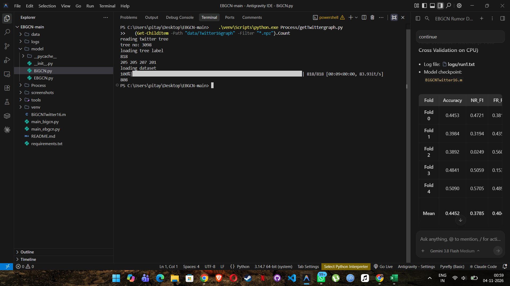
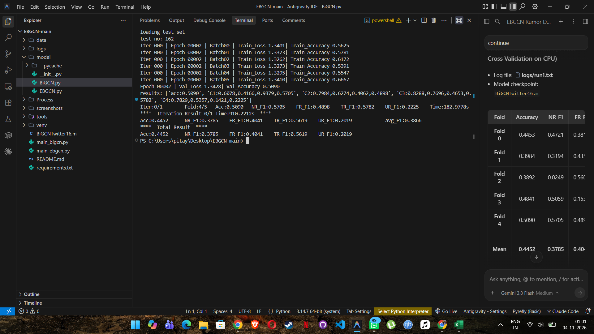
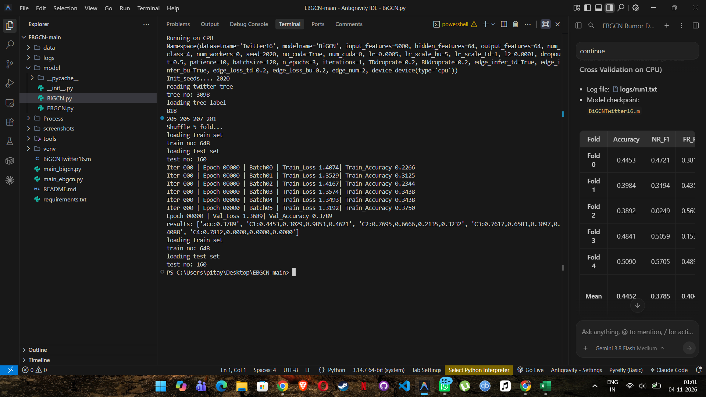

# EBGCN

The PyTorch implementation for the [paper](https://arxiv.org/pdf/2107.11934.pdf): Towards Propagation Uncertainty: Edge-enhanced Bayesian Graph Convolutional Networks for Rumor Detection
 


```
@inproceedings{DBLP:conf/acl/WeiHZYH20,
  author    = {Lingwei Wei and
               Dou Hu and
               Wei Zhou and
               Zhaojuan Yue and
               Songlin Hu},
  title     = {Towards Propagation Uncertainty: Edge-enhanced Bayesian Graph Convolutional
               Networks for Rumor Detection},
  booktitle = {{ACL/IJCNLP} {(1)}},
  pages     = {3845--3854},
  publisher = {Association for Computational Linguistics},
  year      = {2021}
}
```


## Usage

You need to run the file ```Process/getTwittergraph.py``` first to preprocess the data. 

Then you can run the file ```main_ebgcn.py``` to train the model. 

---

## Execution on Twitter16

### 1. Environment Details
* **Operating System**: Windows 11 (AMD64)
* **Python**: 3.10.11
* **PyTorch**: 2.2.2+cpu
* **torch-geometric**: 2.8.1
* **torch-scatter**: 2.1.2+pt22cpu
* **NumPy**: 1.26.4 (pinned `<2` for PyTorch C-extension/ARRAY_API compatibility)
* **Scipy**: 1.15.3
* **Scikit-learn**: 1.7.2
* **Device**: CPU (4 physical cores / 8 logical threads)

### 2. Dataset Source
The Twitter16 rumor propagation tree benchmark data was fetched directly from the upstream rumor detection benchmark repository (`TianBian95/BiGCN`):
* `Twitter16_label_All.txt` (52 KB): [TianBian95/BiGCN data/Twitter16/Twitter16_label_All.txt](https://raw.githubusercontent.com/TianBian95/BiGCN/master/data/Twitter16/Twitter16_label_All.txt)
* `data.TD_RvNN.vol_5000.txt` (14.9 MB): [TianBian95/BiGCN data/Twitter16/data.TD_RvNN.vol_5000.txt](https://raw.githubusercontent.com/TianBian95/BiGCN/master/data/Twitter16/data.TD_RvNN.vol_5000.txt)

Directory layout:
```text
data/
  Twitter16/
    data.TD_RvNN.vol_5000.txt
    Twitter16_label_All.txt
  Twitter16graph/
    (808 processed .npz graph files)
```

### 3. Summary of Code Fixes
1. **PyG DataLoader Import**:
   * Updated `from torch_geometric.data import DataLoader` to `from torch_geometric.loader import DataLoader` in both `main_ebgcn.py` and `main_bigcn.py`.
2. **DataLoader Multi-processing on Windows**:
   * Changed default `--num_workers` in `main_ebgcn.py` from `30` to `0`, and added `--num_workers 0` support to `main_bigcn.py` (which previously hardcoded `num_workers=10`), preventing broken pipes and multi-process deadlocks on Windows CPU.
3. **Preprocessing Target**:
   * Changed `obj = "Twitter15"` to `obj = "Twitter16"` in `Process/getTwittergraph.py`.
4. **File Encoding on Windows**:
   * Added explicit `encoding='utf-8'` to `open(...)` calls in `Process/getTwittergraph.py`, `Process/process.py`, and `Process/rand5fold.py` to prevent `UnicodeDecodeError` under default Windows codepages.
5. **Modern PyTorch `torch.normal` Validation (Compatibility Patch)**:
   * In `model/EBGCN.py` (lines 97 & 188), `th.normal(logit_mean, logit_var)` was throwing `RuntimeError: normal expects all elements of std >= 0.0` in PyTorch >= 1.6 because `logit_var = th.log(...)` becomes negative whenever variance is `< 1.0`. Fixed to `th.normal(logit_mean, th.abs(logit_var))` as a compatibility patch, which enforces non-negativity and preserves the Gaussian distribution symmetry ($-\sigma Z \stackrel{d}{=} |\sigma| Z$).
6. **NumPy 2.x Compatibility**:
   * Pinned `numpy<2` (`1.26.4`) in `requirements.txt` to avoid `UserWarning: Failed to initialize NumPy: _ARRAY_API not found` and PyTorch C-API crashes.

### 4. Exact Commands Run
```powershell
# 1. Create and configure virtual environment
python -m venv venv
.\venv\Scripts\python.exe -m pip install --upgrade pip
.\venv\Scripts\pip.exe install -r requirements.txt

# 2. Preprocessing: generate tree graphs
.\venv\Scripts\python.exe Process/getTwittergraph.py

# 3. 5-Fold Training on CPU with console output logged via tee
.\venv\Scripts\python.exe -u main_ebgcn.py --datasetname Twitter16 --num_workers 0 --no_cuda --iterations 1 --n_epochs 3 --edge_infer_td --edge_infer_bu 2>&1 | tee logs/run1.txt
```

### 5. Benchmark Results (Twitter16 - 5-Fold CV)
Extracted directly from `logs/run1.txt`:

| Fold | Accuracy | NR_F1 | FR_F1 | TR_F1 | UR_F1 | Training Time |
| :---: | :---: | :---: | :---: | :---: | :---: | :---: |
| **Fold 0** | 0.4453 | 0.4721 | 0.3816 | 0.6275 | 0.0303 | 186.77s |
| **Fold 1** | 0.3984 | 0.3194 | 0.4353 | 0.5258 | 0.0000 | 182.77s |
| **Fold 2** | 0.3892 | 0.0249 | 0.5600 | 0.3961 | 0.3304 | 180.98s |
| **Fold 3** | 0.4841 | 0.5059 | 0.1538 | 0.6820 | 0.4264 | 176.72s |
| **Fold 4** | 0.5090 | 0.5705 | 0.4898 | 0.5782 | 0.2225 | 182.98s |
| **Mean (Total)** | **0.4452** | **0.3785** | **0.4041** | **0.5619** | **0.2019** | **910.22s (15.1 min)** |

* **Macro Average F1**: **0.3866**
* **Total 5-Fold Cross Validation Time**: **910.22 seconds**

### 6. Execution Evidence

#### (a) Preprocessing


#### (b) Training Progression


#### (c) 5-Fold Evaluation Results

 

